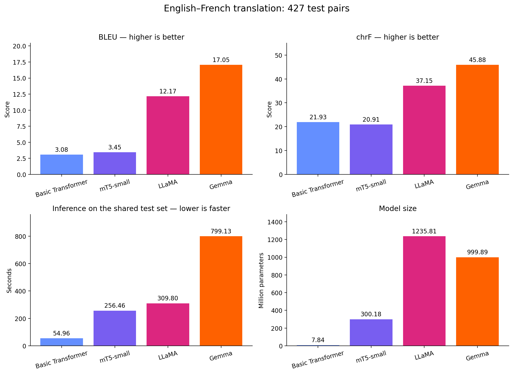
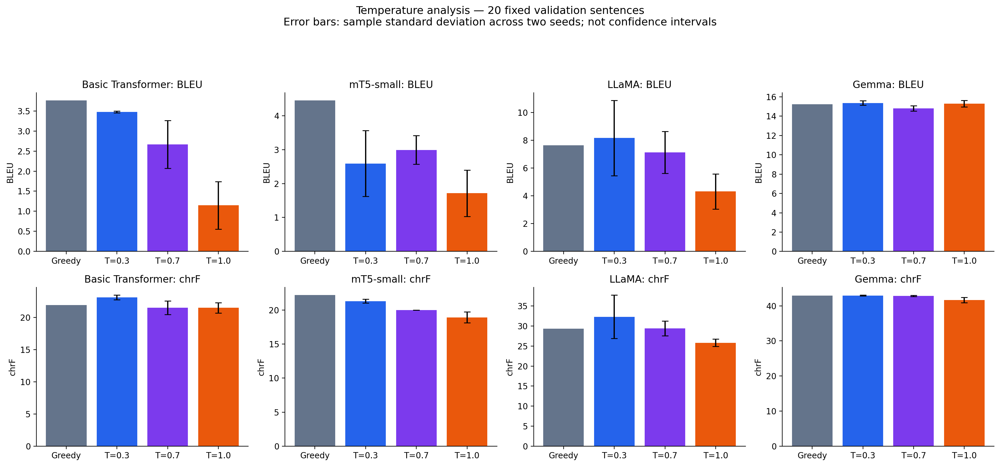

# English-to-French Machine Translation Comparison

ICT4403 — Foundations of Generative AI, Assignment 3

## Objective

Compare a basic Transformer trained from scratch, fine-tuned mT5-small,
and zero-shot prompted LLaMA and Gemma on a shared English-to-French
translation benchmark. Evaluate translation quality, computational
requirements, sampling temperature, and responsible-AI concerns.

## Dataset and preprocessing

Dataset: [OPUS Books](https://huggingface.co/datasets/Helsinki-NLP/opus_books),
English–French configuration (`en-fr`).
Original project: https://opus.nlpl.eu/datasets/Books

The downloaded dataset contained 127,085 pairs. Unicode NFC normalization,
whitespace cleanup, a 3–60-word length filter in each language, and
case-insensitive source/target deduplication retained 117,789 pairs.

A seed-42 shuffle selected an initial 5,000/500/500 train/validation/test split.
A subsequent language audit found reversed language labels. A fixed
`langdetect` rule retained only pairs identified as English source and French
target, each with a detector score of at least 0.90. Existing split membership
was preserved; pairs were not automatically swapped.

Final splits:

- Training: 4175 pairs.
- Validation: 420 pairs.
- Test: 427 pairs.

Detector scores are not calibrated probabilities. This filter can reject
valid short or ambiguous sentences and does not verify semantic alignment.
Splits are sentence-level, not book-disjoint. Related passages and overlap
with model pretraining data may remain.

The original unfiltered run was preliminary and is excluded from the final
four-model comparison.

## Models and adaptation

| Model | Architecture | Adaptation |
|---|---|---|
| Basic Transformer | Encoder–decoder | Trained from random initialization |
| google/mt5-small | Encoder–decoder | Full supervised fine-tuning |
| meta-llama/Llama-3.2-1B-Instruct | Decoder-only | Zero-shot prompting |
| google/gemma-3-1b-it | Decoder-only | Zero-shot prompting |

The basic Transformer uses a randomly initialized BART implementation:
3 encoder and 3 decoder layers, hidden size 256, 4 attention heads, and
feed-forward size 1024. It does not load pretrained BART weights.
It uses learned positional embeddings and a training-only byte-level BPE
tokenizer with an 8,000-token vocabulary.

Basic training used AdamW, learning rate 0.0005, batch size 16, and up to
15 epochs with validation-loss early stopping (patience 3).

mT5 used its pretrained tokenizer, Adafactor, learning rate 0.00005,
microbatch size 1, gradient accumulation 8, gradient checkpointing,
and up to 5 epochs with early-stopping patience 2.

Both trained models selected the checkpoint with the lowest validation loss.
Training histories and measured durations are stored in `results/`.

LLaMA and Gemma received the same translation instruction through their
respective chat templates. Neither received task-specific fine-tuning.
Their training time is therefore N/A; this does not imply that their
original pretraining had no computational cost.

## Review the saved results without retraining

Open `FGAI_Assignment3_Submission.ipynb`. Keep `RUN_EXPERIMENTS = False`.
Upload this entire `ICT4403_Submission` folder into Google Drive's MyDrive;
the notebook defaults to `/content/drive/MyDrive/ICT4403_Submission`.
Install dependencies, restart the runtime if required, and run the review cells.
Model-training cells are skipped. The data and results in this folder are enough
for reviewing the comparison; model checkpoints are not required in review mode.

For a fresh experiment, set `RUN_EXPERIMENTS = True` and choose a new empty
`EXPERIMENT_ROOT`. This performs training and inference and can take substantial
GPU time. The notebook's retained outputs are historical; the reorganized full
GPU workflow has not been rerun after editing.

## Execution and dependencies

The experiments ran in Google Colab using a Tesla T4 GPU.
Actual package versions and Python version are recorded in
`environment_versions.json`.

1. Open the accompanying assignment notebook in a GPU runtime.
2. Keep or install a compatible CUDA-enabled PyTorch build.
3. Install the other dependencies with:
   `pip install -r requirements.txt`
4. Mount Google Drive and configure the project directory.
5. Obtain access to the LLaMA and Gemma model repositories and authenticate
   using a hidden token input. Never commit a token.
6. Follow the final filtered-data workflow in notebook order.
7. Reuse the saved splits for every model. Preserve the original seed and
   language-filter settings when reconstructing the dataset.
8. Run evaluations, temperature experiments, and analysis cells.

The notebook's existing-checkpoint guards prevent accidental overwriting.
If checkpoints already exist, load the final model or resume training
explicitly rather than deleting saved work.

The final submission notebook is included with this README. Large model
checkpoints are excluded from Git and retained separately in Google Drive.

## Evaluation protocol

All models use the same 427 test pairs, verified with a
SHA-256 file hash. Main evaluation uses greedy decoding, one beam,
a maximum of 128 newly generated tokens, and inference batch size 1.

BLEU and chrF are corpus-level SacreBLEU scores on a 0–100 scale.
Metric signatures are saved with the results. Outputs are evaluated as
generated, including extra commentary or wrong-language text.

Encoder–decoder inputs are limited to 256 tokens. Decoder-only chat prompts
are checked against a 2,048-token budget. No source truncation was recorded
in the final test runs. Output-length limits can still affect completeness;
the original evaluation did not record individual stopping reasons.

Inference timing includes tokenization, generation, decoding and loop
overhead, but excludes model loading, warm-up and metric computation.
Training timing includes validation and checkpoint writes, but excludes
preprocessing and final export.

Encoder–decoder models use FP32; decoder-only models use FP16. Timing is
a single-run measurement and is affected by precision, generated length,
implementation and runtime conditions.

## Results

| Model | BLEU | chrF | Training (s) | Inference (s) | Parameters |
|---|---:|---:|---:|---:|---:|
| Basic Transformer | 3.08 | 21.93 | 125.77 | 54.96 | 7,841,792 |
| mT5-small | 3.45 | 20.91 | 4047.07 | 256.46 | 300,176,768 |
| LLaMA | 12.17 | 37.15 | N/A: prompting | 309.80 | 1,235,814,400 |
| Gemma | 17.05 | 45.88 | N/A: prompting | 799.13 | 999,885,952 |

Gemma obtains the highest BLEU and chrF in this experiment, while the basic
Transformer is fastest at inference. LLaMA has lower quality scores than
Gemma but a lower measured inference time.

mT5 only slightly improves BLEU over the basic Transformer, has lower chrF,
and requires substantially more training time. Its outputs still show
repetition and meaning errors. These results apply to this limited-data
fine-tuning setup and do not establish the general capability of mT5.

This is a comparison of systems, not a controlled isolation of architecture.
Model size, pretraining, tokenizer, adaptation method, precision and training
budget all differ.

## Sampling-temperature analysis

A fixed random subset of 20 validation sentences was reused across all
four models. Greedy decoding was compared with sampling at temperatures
0.3, 0.7 and 1.0. Sampled runs used seeds 42 and 43, top-p 1.0 and top-k 0.
The output limit remained 128 new tokens.

| Model | Decoding | BLEU mean ± SD | chrF mean ± SD |
|---|---|---:|---:|
| Basic Transformer | Greedy | 3.76 | 21.93 |
| Basic Transformer | T=0.3 | 3.48 ± 0.02 | 23.14 ± 0.37 |
| Basic Transformer | T=0.7 | 2.66 ± 0.60 | 21.52 ± 1.06 |
| Basic Transformer | T=1.0 | 1.15 ± 0.59 | 21.52 ± 0.81 |
| mT5-small | Greedy | 4.45 | 22.23 |
| mT5-small | T=0.3 | 2.59 ± 0.97 | 21.34 ± 0.29 |
| mT5-small | T=0.7 | 2.99 ± 0.42 | 20.00 ± 0.00 |
| mT5-small | T=1.0 | 1.71 ± 0.68 | 18.95 ± 0.79 |
| LLaMA | Greedy | 7.64 | 29.31 |
| LLaMA | T=0.3 | 8.16 ± 2.71 | 32.32 ± 5.44 |
| LLaMA | T=0.7 | 7.13 ± 1.51 | 29.42 ± 1.88 |
| LLaMA | T=1.0 | 4.32 ± 1.27 | 25.81 ± 0.92 |
| Gemma | Greedy | 15.24 | 42.94 |
| Gemma | T=0.3 | 15.37 ± 0.24 | 42.97 ± 0.12 |
| Gemma | T=0.7 | 14.81 ± 0.28 | 42.86 ± 0.18 |
| Gemma | T=1.0 | 15.30 ± 0.34 | 41.67 ± 0.79 |

Standard deviations describe variation across only two seeds, not confidence
intervals. The small subset supports exploratory observations only:

- Basic Transformer: greedy has the highest BLEU; temperature 0.3 has the
  highest average chrF.
- mT5: greedy performs best on both metrics.
- LLaMA: temperature 0.3 has the highest averages but substantial variation.
- Gemma: greedy and temperature 0.3 are similar; temperature 1.0 reduces chrF.

The main test benchmark remains greedy. These validation experiments were
not used to replace the reported test scores.

## Qualitative review

Ten test examples were sampled with seed 42 independently of output quality.
Source text, references, all four predictions and assisted review notes are
stored in `results/manual_translation_review.csv`.

Observed failures include:

- Incorrect dates, names and locations: mT5 changes May to August; LLaMA
  invents a street; Gemma replaces Buonaparte with “Appientain.”
- Extensive repetition and omissions, particularly in the trained
  encoder–decoder outputs, but also in a long LLaMA output.
- Wrong-language content: Gemma copies an English sentence; other outputs
  retain untranslated English words.
- Changed intent: an expression about leaving fighting becomes going to war.
- Register differences, lost wordplay and unwanted explanatory commentary.

References are not perfect ground truth. One adds a detail absent from the
source, another contains an encoding artifact, and some reflect literary
context unavailable from a single sentence. Alternative valid translations
may therefore receive lower automatic scores.

Review notes were produced with AI assistance and require student verification;
they are not an independent expert bilingual assessment.

## Responsible AI and limitations

Factual substitutions and omissions could mislead readers about events,
locations or a speaker's intent. Appropriate mitigations include source-based
checks of names, dates, numbers and negation; output-language checks; and
bilingual human review when accuracy matters.

Literal translations of idioms and changes in politeness can misrepresent
cultural meaning. Surrounding context and culturally competent review are
important, especially where English “you” leaves French register ambiguous.

One reviewed sentence expresses despair. Poor translation may obscure its
emotional meaning. This isolated example does not establish performance
across medical, legal, abusive or other sensitive content. Sensitive-domain
use requires separate evaluation and appropriate human oversight.

Demographic bias was not systematically measured. Historical literary data
may contain dated stereotypes and has limited domain coverage. Future work
should include balanced, controlled examples across demographic groups and
report subgroup performance without assuming neutrality.

Protect private text, review dataset and model usage terms, disclose
machine-generated translations, and avoid treating BLEU or chrF as measures
of safety or factual reliability.

## Conclusion

Gemma is the best-performing model by both automatic quality metrics in
this experiment, but has the highest measured inference time and still
makes substantial individual errors. LLaMA offers a different quality–speed
trade-off. The basic Transformer is fastest but has weak translation quality.

Results are limited by the small literary dataset, imperfect references,
language-filter selection, potential pretraining overlap and differing model
configurations. They do not justify a general claim that one architecture
is always superior.

## Repository contents

- Assignment notebook: implementation and execution workflow.
- `requirements.txt`: installed non-PyTorch dependency versions.
- `environment_versions.json`: Python, package and device information.
- `data/`: fixed splits, metadata and language-filter log.
- `results/`: model metrics, predictions and manual review.
- `results/temperature/`: fixed validation subset and temperature results.
- `results/plots/`: comparison figures.
- `checkpoints/`: retained separately; excluded from Git.

## Sources

- Dataset: https://huggingface.co/datasets/Helsinki-NLP/opus_books
- mT5: https://huggingface.co/google/mt5-small
- LLaMA: https://huggingface.co/meta-llama/Llama-3.2-1B-Instruct
- Gemma: https://huggingface.co/google/gemma-3-1b-it
- SacreBLEU: https://github.com/mjpost/sacrebleu

## Assistance disclosure

AI assistance was used for code development, troubleshooting, documentation
and translation-review suggestions. The student must verify the submitted
work and follow the institution's disclosure requirements.
